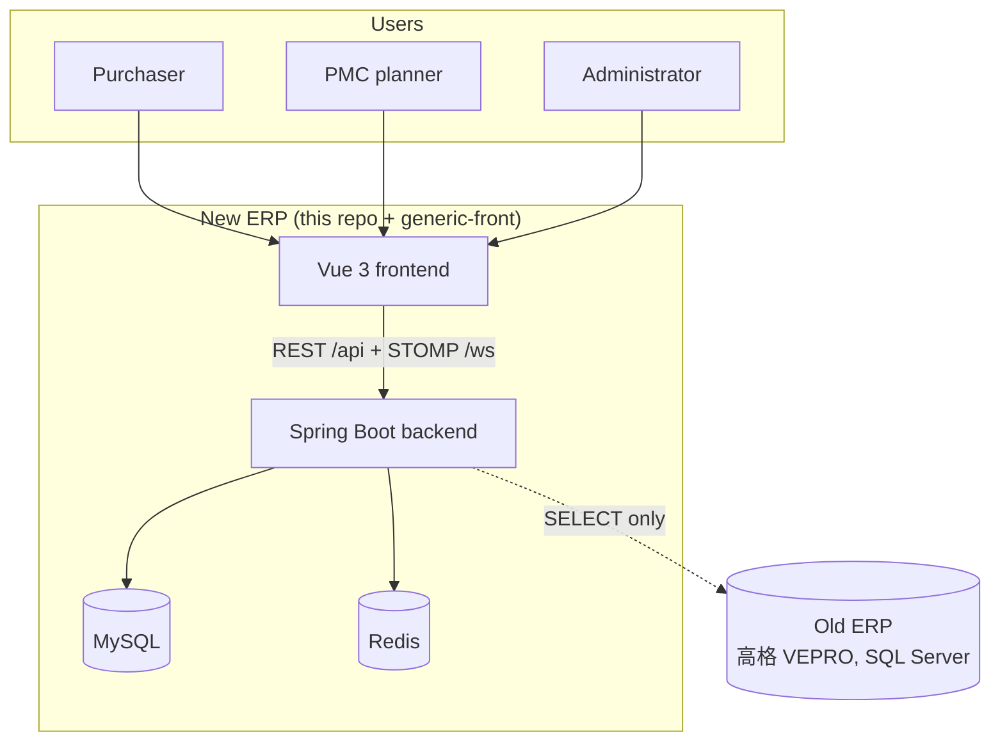
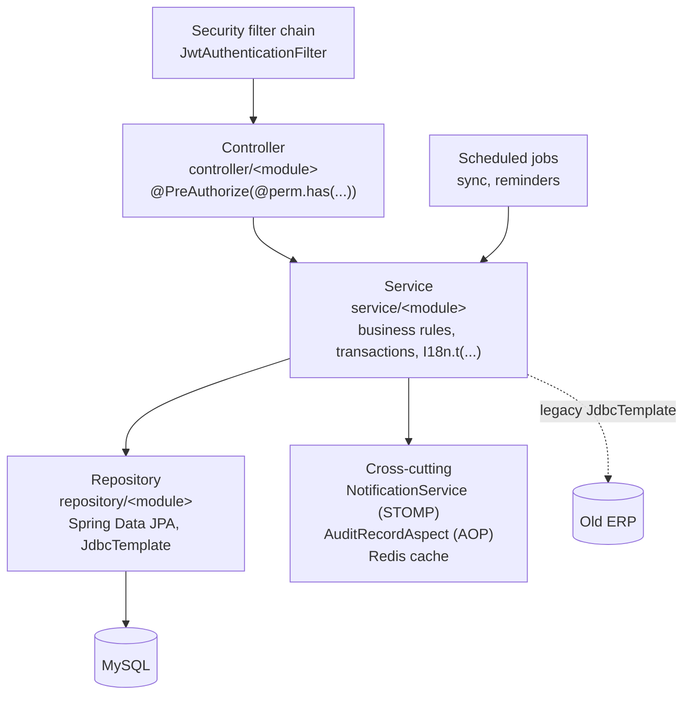
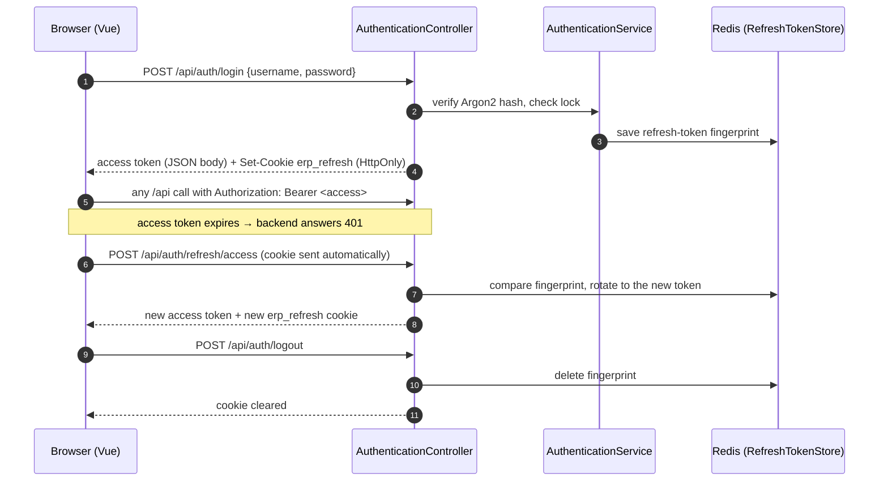
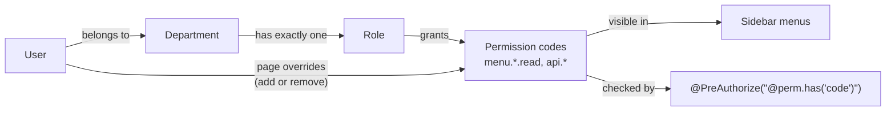
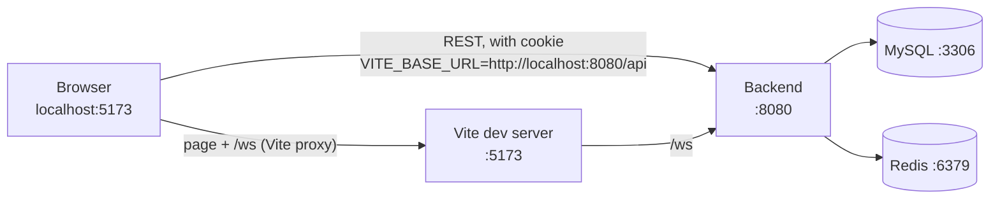
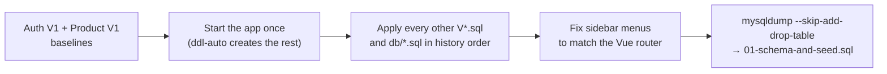
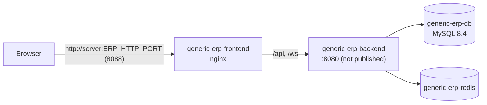

# Generic ERP Backend — Development Guide

> **Last updated:** 2026-11-28 · **Version:** `1.0.1 Snapshot` · **Branch model:** feature branch → PR → `main`

This guide is for developers who change the backend. It explains how the code is organized, how a
request flows through it, how to run it on your own machine, and the rules every change follows.
For a short overview see [README.md](README.md); for server deployment see
[deploy/README.md](deploy/README.md).

## Table of contents

1. [System context](#1-system-context)
2. [Architecture](#2-architecture)
3. [Security model](#3-security-model)
4. [Localization](#4-localization)
5. [Local development](#5-local-development)
6. [Configuration reference](#6-configuration-reference)
7. [Database and schema changes](#7-database-and-schema-changes)
8. [Old ERP sync and scheduled jobs](#8-old-erp-sync-and-scheduled-jobs)
9. [Testing](#9-testing)
10. [Docker deployment in short](#10-docker-deployment-in-short)
11. [Conventions and adding a module](#11-conventions-and-adding-a-module)
12. [Module status](#12-module-status)

---

## 1. System context

The new ERP does **not** replace the old ERP (高格 VEPRO on SQL Server) yet. The old ERP stays the
system of record for sales orders and purchase orders. This backend:

- **reads** sales orders and purchase orders from the old ERP every 15 minutes (read-only login);
- **stores** its own data in MySQL: follow-up records, placement tasks, quotations, exceptions,
  order-audit tasks, users and permissions;
- **pushes** notifications to the browser over WebSocket (STOMP).



## 2. Architecture

### 2.1 Layers

The code uses a classic layered design. Each layer only calls the layer directly below it.



- **Controllers** only map HTTP to service calls and return `BasicResponse<T>` /
  `BasicPageResponse<T>`. They never return JPA entities.
- **Services** hold the business rules and own the transactions.
- **Repositories** are Spring Data JPA interfaces. Complex read models use `JdbcTemplate` or the
  database views mapped in `view/`.
- **`GlobalExceptionHandler`** turns exceptions into the same response envelope, with a
  localized message.

### 2.2 Packages

```
com.gsgd.generic_erp
├── annotations/          custom annotations (for example audit markers)
├── aop/                  AuditRecordAspect + audit events
├── configuration/
│   ├── security/         JWTUtil, JwtAuthenticationFilter, PermissionChecker (@perm), RoleGuard,
│   │                     RefreshTokenStore (Redis), WebSecurityConfiurer
│   ├── i18n/             I18n, LocalizedText, locale resolver and interceptor
│   ├── message/          WebSocketConfig (/ws), STOMP auth, NotificationService
│   ├── scheduling/       SchedulingConfig
│   └── exception/        domain exceptions
├── controller/           admin, auth, customer, dashboard, notification, pmc, product, purchase
├── service/              same modules; *Job classes are the scheduled jobs
├── repository/           admin, audit, auth, customer, notification, product, purchase
├── entity/ dto/          JPA entities and API objects, one sub-package per module
├── pmc/                  PMC order audit module (kept together: entities, services, controllers)
├── redis/                Redis configuration
├── spec/                 JPA Specifications for dynamic filters
├── view/                 database view mappings and their SQL
├── enums/  util/         shared enums, BasicResponse, pagination helpers
└── GenericErpApplication.java
```

### 2.3 Modules and API paths

| Module | Controller(s) | Base path |
|---|---|---|
| Authentication | `AuthenticationController` | `/api/auth` (`/login`, `/refresh/access`, `/logout`) |
| Current user | `UserController` | `/api/users` (sidebar menu, personal dashboard) |
| User management | `UserManagementController` | `/api/root` |
| Departments and roles | `DepartmentController`, `RoleController` | `/api/admin/departments`, `/api/admin/roles` |
| Permissions and menus | `PermissionController`, `PermissionManagementController`, `ManipulatePermissionController`, `MenuController` | `/api/admin/permissions`, `/api/permission`, `/api/permission/manipulate`, `/api/manager/menu` |
| Product master | `ProductController`, `ProductCategoryController` | `/api/product`, `/api/admin/product` |
| Customer orders | `CustomerOrderController` | `/api/customer-orders` |
| Purchase orders and follow-up | `PurchaseOrderController`, `FollowUpController`, `FollowUpTemplateController`, `FollowUpPlanGroupController` | `/api/purchase-orders`, `/api/followups`, `/api/followup-templates`, `/api/followup-plan-groups` |
| Placement tasks | `PlacementTaskController` | `/api/placement-tasks` |
| Quotations | `QuotationController` | `/api/quotations` |
| Purchasing exceptions | `PurchaseExceptionController` | `/api/purchase-exceptions` |
| PMC order audit | `OrderAuditController`, `AuditEvidenceController`, `RuleEvidenceController`, `PersonalEvidenceController` | `/api/pmc/order-audit-tasks`, `/api/pmc/evidence` |
| Dashboards | `DashboardController` | `/api/dashboards` |
| Notifications | `NotificationController` + STOMP | `/api/notifications`, WebSocket `/ws` |
| Files | `FileController` | `/api/uploads`, `/api/uploads/chunk`, `/api/file/merge` |

Business rules per feature are written up in [`Implementation Doc/`](Implementation%20Doc) (one
folder per feature, with its SQL) and [`docs/`](docs).

## 3. Security model

### 3.1 Login and token refresh

The access token is short-lived (15 minutes by default) and travels in the `Authorization`
header. The refresh token is long-lived (7 days) and travels **only** in an HttpOnly cookie named
`erp_refresh` (path `/api/auth`, `SameSite=Strict`). JavaScript can never read it. Redis keeps a
SHA-256 fingerprint of the current refresh token per session and rotates it atomically on every
refresh, so a stolen old token stops working.



Important consequences:

- The API **must** stay under `/api` on the **same site** as the page, or the cookie is not sent.
  Docker solves this with nginx; local development works because `localhost:5173` and
  `localhost:8080` are the same site.
- `JWTUtil` refuses to start when a signing secret is shorter than **32 bytes**. Use two
  different values: `openssl rand -base64 48`.
- After `LOGIN_MAX_FAILED_ATTEMPTS` (default 3) wrong passwords, the account is locked for
  `LOGIN_LOCK_DURATION_MS` (default 15 minutes).

### 3.2 Permissions (RBAC)



- Each department has **one role**; a user gets the role of their department. Per-user page
  overrides can add or remove single pages (see `Implementation Doc/Department Roles`).
- Every controller method declares the permission it needs with
  `@PreAuthorize("@perm.has('menu.xxx.read')")`. `PermissionChecker` is the `@perm` bean.
  `ControllerPermissionCoverageTest` fails when a new endpoint has no permission check.
- The frontend hides what the user cannot do, but the backend always checks again.
- The `root` user (role ROOT) can do everything.

## 4. Localization

**Rule for every change:** all text the user can see is localized, and backend messages use the
same language as the frontend.

- The frontend sends `Accept-Language: zh-CN` or `en-US` on every request and on the STOMP
  CONNECT frame. `I18nConfig` resolves the locale from that header. Without a header, the
  default is `ERP_DEFAULT_LOCALE` (`zh-CN`).
- Write messages with `I18n.t("key", args...)`. Add every key to **both** bundles:
  - `src/main/resources/i18n/messages.properties` (English)
  - `src/main/resources/i18n/messages_zh_CN.properties` (Simplified Chinese)
- `MessageFormat` is always on, so a literal apostrophe is written `''`. `I18nTest` fails on a
  single `'`.
- Pass ids to `I18n.t` as `String`. A number is formatted with grouping (`12,345`).
- Text that is shown **later** (notifications) is stored as `LocalizedText.of(key, args)` and
  rendered in the language of the person who reads it, not the person who caused it.

## 5. Local development

### 5.1 Prerequisites

| Tool | Version | Why |
|---|---|---|
| JDK | 21 recommended (18 or newer) | `pom.xml` targets 18; the Docker image uses 21 |
| Docker | any recent | MySQL and Redis for local runs |
| IDE | IntelliJ IDEA (Lombok plugin) or similar | Lombok generates getters, builders, constructors |
| Maven | not needed | use the wrapper `./mvnw` |

### 5.2 Start MySQL and Redis

Use the same database init script as production, so you get every table, all menus and
permissions, and the `root` account:

```bash
# MySQL 8.4, initialized once from deploy/db/init (only when the volume is empty)
docker run -d --name erp-dev-mysql \
  -e MYSQL_ROOT_PASSWORD=devroot \
  -e MYSQL_DATABASE=generic_erp \
  -e MYSQL_USER=erp -e MYSQL_PASSWORD=devpass \
  -p 3306:3306 \
  -v erp-dev-mysql:/var/lib/mysql \
  -v "$PWD/deploy/db/init:/docker-entrypoint-initdb.d:ro" \
  mysql:8.4 --character-set-server=utf8mb4 --collation-server=utf8mb4_0900_ai_ci

# Redis 7 with a password
docker run -d --name erp-dev-redis -p 6379:6379 redis:7-alpine redis-server --requirepass devredis
```

### 5.3 Create `.env` in the project root

`spring-dotenv` loads this file at startup. It is in `.gitignore`; never commit it.

```env
# Database
DB_URL=jdbc:mysql://localhost:3306/generic_erp?useSSL=false&allowPublicKeyRetrieval=true&serverTimezone=Asia/Shanghai&characterEncoding=utf8
DB_USERNAME=erp
DB_PASSWORD=devpass
DB_DRIVER_CLASS_NAME=com.mysql.cj.jdbc.Driver

# Redis
REDIS_HOST=localhost
REDIS_PORT=6379
REDIS_PASSWORD=devredis

# JWT: two different values, at least 32 bytes each (openssl rand -base64 48)
AUTHENTICATION_SECRET_KEY_ACCESS=<paste value 1>
AUTHENTICATION_SECRET_KEY_REFRESH=<paste value 2>
ACCESS_TIMEOUT=900000
REFRESH_TIMEOUT=604800000
AUTH_COOKIE_SECURE=false          # plain HTTP on localhost

# Frontend dev server
CORS_ALLOWED_ORIGINS=http://localhost:5173,http://127.0.0.1:5173

# Folder for uploaded files
FILE_PATH=/tmp/generic-erp-files

# Old ERP sync stays off unless you have a read-only SQL Server login
LEGACY_ERP_ENABLED=false
```

### 5.4 Run

```bash
./mvnw spring-boot:run            # or run GenericErpApplication from the IDE
curl http://localhost:8080/actuator/health   # {"status":"UP"}
```

Then start the frontend (`cd ../generic-front/app && npm run dev`) and open
`http://localhost:5173`. Log in as **root / ChangeMe@2026**.



The default profile logs every SQL statement (`show-sql: true`, `DEBUG` for Hibernate and
`JdbcTemplate`) to the console and to `generic_erp.log`. The `docker` profile turns this off.

## 6. Configuration reference

All settings are in `src/main/resources/application.yml` and read from environment variables.
`application-docker.yml` only changes logging, health details and proxy headers.

| Variable | Default | Meaning |
|---|---|---|
| `DB_URL`, `DB_USERNAME`, `DB_PASSWORD`, `DB_DRIVER_CLASS_NAME` | — (required) | MySQL connection |
| `REDIS_HOST`, `REDIS_PORT`, `REDIS_PASSWORD` | — (required) | Redis connection (database 1) |
| `AUTHENTICATION_SECRET_KEY_ACCESS`, `AUTHENTICATION_SECRET_KEY_REFRESH` | — (required) | JWT signing secrets, ≥ 32 bytes, different |
| `ACCESS_TIMEOUT`, `REFRESH_TIMEOUT` | — (required) | Token lifetimes in ms (15 min / 7 days in `.env.example`) |
| `AUTH_COOKIE_SECURE` | `true` | `true` sends the refresh cookie over HTTPS only; set `false` for plain HTTP |
| `CORS_ALLOWED_ORIGINS` | `http://localhost:5173,http://127.0.0.1:5173` | Origins allowed for REST and `/ws` |
| `LOGIN_MAX_FAILED_ATTEMPTS`, `LOGIN_LOCK_DURATION_MS` | `3`, `900000` | Account lock |
| `FILE_PATH` | — (required) | Folder for uploaded files |
| `ERP_DEFAULT_LOCALE` | `zh-CN` | Language when a request has no `Accept-Language` |
| `ERP_PURCHASE_ZONE` | `Asia/Shanghai` | Time zone for jobs and deadlines |
| `ERP_FOLLOWUP_JOB_ENABLED` | `true` | Hourly follow-up reminder job |
| `ERP_PLACEMENT_JOB_ENABLED`, `ERP_PLACEMENT_CRON`, `ERP_PLACEMENT_TRIGGER` | `true`, every 15 min, `CONFIRMATION` | Placement task job |
| `ERP_QUOTATION_ORDER_SCOPE`, `ERP_QUOTATION_LOOKBACK_DAYS`, `ERP_QUOTATION_INCLUDE_PARTLY_BOUGHT`, `ERP_QUOTATION_PACKAGING_CLASSES` | `all`, `90`, `true`, `3` | Which sales orders the quotation list shows, and which material classes count as packaging |
| `ERP_EXCEPTION_NOTIFY_ROLES`, `ERP_EXCEPTION_NOTIFY_DEPT_IDS` | `purchaser,pmc`, empty | Who is notified about a purchasing exception |
| `ERP_EXCEPTION_APPROVER_DEPT_NAMES`, `ERP_EXCEPTION_APPROVER_DEPT_IDS` | `PMC`, empty | Who approves a purchasing exception |
| `LEGACY_ERP_ENABLED` | `false` | Switches the old-ERP sync on |
| `LEGACY_ERP_DB_URL`, `LEGACY_ERP_DB_USERNAME`, `LEGACY_ERP_DB_PASSWORD` | — | Read-only SQL Server login |
| `LEGACY_ERP_PO_SYNC_CRON`, `LEGACY_ERP_CO_SYNC_CRON` | every 15 min | Purchase order / customer order sync schedule |

## 7. Database and schema changes

There is **no Flyway or Liquibase yet**. Two mechanisms work together:

1. **Hibernate `ddl-auto: update`** creates missing tables and columns from the entities at
   startup. It never drops or renames anything.
2. **Hand-written SQL migrations** (`V*.sql`) add what Hibernate cannot: seed data (roles,
   permission codes, menus), views, and column fixes. They live next to their feature in
   `Implementation Doc/<Feature>/` and in `src/main/resources/db/`. Run them by hand, in order,
   on every existing database.

`deploy/db/init/01-schema-and-seed.sql` is the **complete** schema plus required seed data for an
empty database. MySQL runs it once, when its data volume is empty. It was produced like this:



**When your change adds a menu, a permission code or other seed data:**

1. Write a new migration `V<n>__<what>.sql` in the feature folder (idempotent: `INSERT IGNORE`
   or `WHERE NOT EXISTS`).
2. Run it on your local database and on the server.
3. Regenerate `deploy/db/init/01-schema-and-seed.sql` the same way (or append the same
   statements to it), so a fresh install gets it too.

Known traps in old seed scripts: the V2 auth seed misses the NOT NULL columns
`user_roles_tb.user_enabled` and `menu_registered_permissions_record.permission_enabled`; a
sidebar parent only shows its children when the parent's route is empty; the sidebar ignores
`is_enabled`, so delete a menu row to hide it.

## 8. Old ERP sync and scheduled jobs

`SchedulingConfig` enables Spring scheduling. All cron times use `ERP_PURCHASE_ZONE`.

| Job | Default schedule | What it does |
|---|---|---|
| `PurchaseOrderSyncJob` | every 15 min | Reads approved POs and lines from `ORDSPHS1` / `ORDSPHS2` (+ `SUPPLIER`, `PRODUCT`) changed since the last run (first run: last 60 days) |
| `CustomerOrderSyncJob` | every 15 min | Reads new customer orders (`ORDCORD1`) and notifies PMC |
| `PlacementTaskJob` | every 15 min | Creates placement tasks (deadline 2 days), reminds the assignee 12 h before the deadline, sends one overdue alert |
| `FollowUpReminderJob` | hourly | Reminds purchasers about follow-ups that are due |

The two sync jobs only run when `LEGACY_ERP_ENABLED=true`. The SQL they run is in
`application.yml` under `erp.legacy`. Use a **SELECT-only** SQL Server login. All queries use
`WITH (NOLOCK)` and never write to the old ERP.

> Spring 7 gotcha: `JdbcTemplate.setMaxRows(0)` now means "keep 0 rows". Use `-1` for no limit.

## 9. Testing

```bash
./mvnw test                                   # all tests (about a minute)
./mvnw test -Dtest=I18nTest                   # one class
./mvnw test -Dtest='PermissionCheckerTest#*'  # one class, all methods
```

- **215 tests** as of 2026-11-28. They need no MySQL and no Redis: services are tested with
  Mockito, and `AuditIntegrationTest` uses an in-memory H2 database.
- **Known failures (2):** `AuditIntegrationTest.multipartEvidenceUsesTaskScopeAndCanBeReplayedSafely`
  and `standaloneUploadsAreIdempotentAndRejectChangedContent`. The expected `Instant` has
  nanoseconds and the stored one has microseconds. This is a test precision problem, not a
  deployment problem.
- Guard-rail tests worth knowing: `ControllerPermissionCoverageTest` (every endpoint has a
  permission), `MethodSecurityEnforcementTest`, `I18nTest` (both bundles have the same keys and
  valid `MessageFormat`), `JWTUtilTest` (secret length).

## 10. Docker deployment in short

Full guide: [deploy/README.md](deploy/README.md).



- Run `docker compose up -d --build` from `deploy/`. The backend image is built from this repo's
  `Dockerfile`, the frontend image from `../../generic-front/app` (`FRONTEND_DIR`).
- Only `ERP_HTTP_PORT` (default **8088**) is published. MySQL can be opened on
  `127.0.0.1:3308` with `docker-compose.db-port.yml` for admin tools.
- Every container, network and volume name starts with `generic-erp`, so the stack can run next
  to other Compose projects on the same server.
- MySQL reads `MYSQL_*PASSWORD` **only** on the first start of an empty volume. Changing them
  later in `.env` does not change the database; use `ALTER USER` instead.
- Log in as `root / ChangeMe@2026` and change the password immediately.

## 11. Conventions and adding a module

### Conventions

- Package per module: `controller/<module>`, `service/<module>`, `repository/<module>`,
  `entity/<module>`, `dto/<module>`.
- DTOs (Java records are welcome) for everything leaving a service. Never expose entities.
- Lombok: `@Data`, `@Builder`, `@RequiredArgsConstructor` are the approved annotations.
- Every endpoint: `@PreAuthorize("@perm.has('<code>')")` and a `BasicResponse` result.
- Every user-visible message: `I18n.t(...)` with keys in both bundles.
- Settings come from `application.yml` with an environment variable and a sensible default.
- Commit messages: short imperative summary (`Quotation: add per-unit calculation`).

### Checklist for a new module

1. Entities in `entity/<module>` (Hibernate creates the tables locally).
2. Repository, service, DTOs, controller with permission checks.
3. Permission codes and the sidebar menu in a new `V<n>__<module>.sql` under
   `Implementation Doc/<Module>/`; grant them to the ROOT role.
4. Message keys in `messages.properties` and `messages_zh_CN.properties`.
5. Tests: service tests with Mockito; run `ControllerPermissionCoverageTest` and `I18nTest`.
6. Update `deploy/db/init/01-schema-and-seed.sql` so new installs get the menus.
7. The frontend part: route, page, labels in both language files (see generic-front
   `DEVELOPMENT.md`).

## 12. Module status

| Module | Status |
|---|---|
| Authentication, refresh cookie, account lock | Done |
| Users, departments (one role per department), page overrides | Done |
| Permission codes, menus, permission admin | Done |
| Localization (zh-CN / en-US) incl. notifications | Done |
| Notifications over WebSocket | Done |
| Chunked file upload | Done |
| Product master (backend) | Done; frontend page still empty |
| Customer order sync + PMC review list | Done |
| Purchase order sync, follow-up records, templates, plan groups, reminders | Done |
| Placement tasks | Done |
| Purchasing exceptions with PMC approval | Done |
| Quotations (报价方案) with Excel export | Done; rules still being refined with purchasing |
| PMC order audit and evidence | Done |
| Purchasing and PMC dashboards | Done |
| Docker Compose deployment | Done |
| Flyway / Liquibase migrations | Not started (manual `V*.sql` for now) |
| BOM, demand review, warehouse, formal PO creation | Not started (Phase 1 design in the ERP Design folder) |
