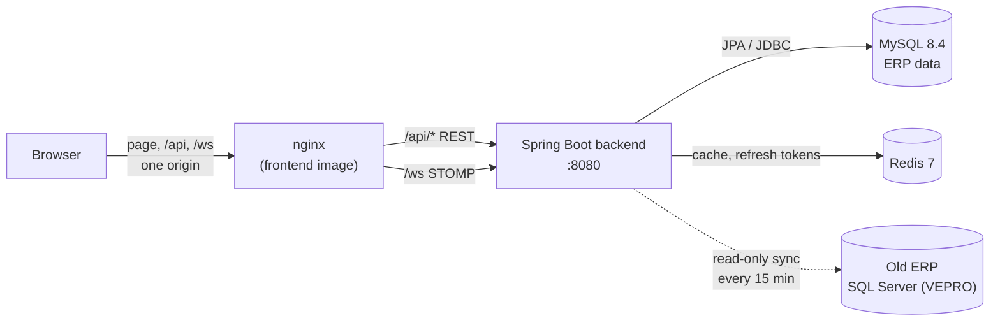

# Generic ERP — Backend

The Spring Boot backend of the **Generic ERP** system. It serves a JSON REST API and a STOMP
WebSocket to the Vue 3 frontend ([generic-front](https://github.com/GenesisYoung/generic-front)).

The new ERP works **next to** the old ERP (高格 VEPRO, SQL Server). The old ERP stays the system of
record: this backend reads customer orders and purchase orders from it (read-only sync) and adds
the work the old system does not do: purchase follow-up, placement tasks, quotations, purchasing
exceptions with PMC approval, PMC order audit, dashboards and notifications.

> **Where to go next**
> - Deploy on a server: [deploy/README.md](deploy/README.md)
> - Develop locally, architecture, conventions: [DEVELOPMENT.md](DEVELOPMENT.md)
> - Per-feature SQL migrations and design notes: [`Implementation Doc/`](Implementation%20Doc) and [`docs/`](docs)

## What it does

| Area | What the user gets | API base path |
|---|---|---|
| Login and sessions | Username + password login, JWT access token, refresh token in an HttpOnly cookie, account lock after failed attempts | `/api/auth` |
| Users, departments, roles | User management, one role per department, page overrides per user | `/api/root`, `/api/admin/departments`, `/api/admin/roles` |
| Permissions and menus | Permission codes, sidebar menus, who can see what | `/api/admin/permissions`, `/api/permission`, `/api/manager/menu`, `/api/users` |
| Product master data | Products and product categories | `/api/product`, `/api/admin/product` |
| Customer orders | Sales orders synced from the old ERP | `/api/customer-orders` |
| Purchase orders and follow-up | POs synced from the old ERP, follow-up records, templates, plan groups, reminders | `/api/purchase-orders`, `/api/followups`, `/api/followup-templates`, `/api/followup-plan-groups` |
| Placement tasks | "Place the purchase order" tasks with deadlines and reminders | `/api/placement-tasks` |
| Quotations (报价方案) | Cost quotation per sales order from BOM + purchase prices, Excel export | `/api/quotations` |
| Purchasing exceptions | Report an exception, PMC approves or rejects it | `/api/purchase-exceptions` |
| PMC order audit | Order review tasks, rules and evidence files | `/api/pmc/...` |
| Dashboards | Purchasing and PMC dashboard tiles | `/api/dashboards` |
| Notifications | Stored notifications, pushed live over WebSocket | `/api/notifications`, `/ws` |
| Files | Chunked upload and merge | `/api/uploads`, `/api/file/merge` |

Every response uses the same envelope (`BasicResponse<T>`, or `BasicPageResponse<T>` for pages).
Every message the backend returns is localized (Simplified Chinese or English) and follows the
frontend's language, which the frontend sends in `Accept-Language`.

## How it fits together



## Tech stack

| Category | Technology | Version |
|---|---|---|
| Language | Java | 18 in `pom.xml` (the Docker image builds and runs on 21) |
| Framework | Spring Boot (Web MVC, Security, Data JPA, Data JDBC, WebSocket, Cache, AOP, Actuator) | 4.0.5 |
| Authentication | JWT with JJWT, Argon2 password hashing (BouncyCastle) | 0.12.6 / 1.78.1 |
| Database | MySQL (ERP data), H2 (some tests) | 8.4 |
| Cache and token store | Redis (Lettuce pool) | 7 |
| Old ERP access | Microsoft SQL Server JDBC driver, read-only | Boot-managed |
| Excel export | Apache POI | 5.3.0 |
| Configuration | `.env` file via spring-dotenv | 5.1.0 |
| Build | Maven (wrapper included) | 3.9 |

## Quick start

### Option A: run the whole system with Docker Compose (recommended for a server)

Clone both repositories next to each other, then:

```bash
cd generic_erp/deploy
cp .env.example .env          # replace every "change-me"; secrets: openssl rand -base64 48
docker compose up -d --build
docker compose ps             # wait until all four services are "healthy"
```

Open `http://<server>:8088` and log in as **root / ChangeMe@2026**. Change the password at once.
Ports, backups, HTTPS and other details are in [deploy/README.md](deploy/README.md).

### Option B: run the backend from your IDE (development)

You need JDK 21 (18 or newer works), Docker for MySQL and Redis, and a `.env` file in the project
root. The full step-by-step guide, including the `.env` template, is in
[DEVELOPMENT.md → Local development](DEVELOPMENT.md#5-local-development).

```bash
./mvnw spring-boot:run        # API at http://localhost:8080/api
./mvnw test                   # 215 tests; no MySQL or Redis needed (mocks + in-memory H2)
```

## Project layout

```
generic_erp/
├── src/main/java/com/gsgd/generic_erp/
│   ├── configuration/    security (JWT, permission checks), i18n, WebSocket, scheduling, exceptions
│   ├── controller/       REST endpoints, one package per module
│   ├── service/          business logic and scheduled sync / reminder jobs
│   ├── repository/       Spring Data JPA repositories
│   ├── entity/  dto/     database entities and API objects (entities never leave the service layer)
│   ├── pmc/              PMC order audit module (tasks, rules, evidence)
│   └── aop/              audit-record aspect and events
├── src/main/resources/
│   ├── application.yml           all settings; values come from environment variables
│   ├── application-docker.yml    overrides used inside the Docker image
│   ├── i18n/messages*.properties backend texts in English and Simplified Chinese
│   └── db/*.sql                  extra migrations (order audit, evidence, menus)
├── Implementation Doc/   per-feature design notes and V*.sql migrations
├── docs/                 module requirements and fix write-ups
├── deploy/               Docker Compose stack, .env.example, database init script
└── Dockerfile            backend image (Maven build → Temurin 21 JRE)
```

## License and ownership

Designed and developed by Genesis Young. Private project.
