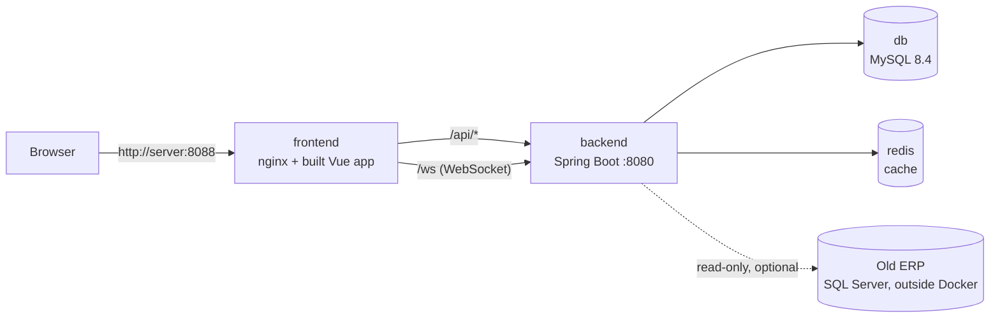

# Deploying Generic ERP with Docker Compose

## What runs



- Only the **frontend** port is published. The browser loads the page and calls `/api` on the same
  address, and nginx forwards it to the backend. Same origin means no CORS errors, and the refresh
  cookie (path `/api/auth`) works.
- `db/init/01-schema-and-seed.sql` creates every table and the seed data. MySQL runs it **once**,
  the first time the `db-data` volume is empty.
- The old ERP is not a container. Set `LEGACY_ERP_*` in `.env` to switch the sync on.

## Ports and names (safe next to other Compose stacks)

| What | Host port | Notes |
|---|---|---|
| ERP website + API (`frontend`) | `ERP_HTTP_PORT`, default **8088** | The only published port |
| Backend | none | Reached through nginx at `/api` |
| MySQL | none | Optional: `127.0.0.1:${ERP_MYSQL_HOST_PORT}` (default 3308) with `docker-compose.db-port.yml` |
| Redis | none | |

Every container, the network and the volumes start with `generic-erp` (project name, container
names, `generic-erp-net`, `generic-erp-db-data`, ...), so nothing is shared with another stack such
as `collab_dashboard` (which uses 8081, 5174, 3307, 5673, 15673).

Before the first start, check that the port is free: `sudo ss -ltnp | grep ':8088 '` (no output = free).
If it is taken, set another `ERP_HTTP_PORT` and the same port in `PUBLIC_URL`.

## Folder layout

Clone both repositories next to each other (or set `FRONTEND_DIR` in `.env`):

```
some-folder/
├── generic_erp/        ← this repo (run compose from generic_erp/deploy)
└── generic-front/      ← frontend repo (Dockerfile is in generic-front/app)
```

## First deploy

```bash
cd generic_erp/deploy
cp .env.example .env
# Edit .env: replace every "change-me". Generate secrets with: openssl rand -base64 48
# Set PUBLIC_URL to the address users type, e.g. http://192.168.1.50:8088
docker compose up -d --build
docker compose ps            # wait until all four services are "healthy" (1-2 minutes)
```

Open `PUBLIC_URL` and log in with **root / ChangeMe@2026**, then change the password at once.

## Everyday commands

| Task | Command |
|---|---|
| Update to the latest code | `git pull` in both repos, then `docker compose up -d --build` |
| Backend logs | `docker compose logs -f backend` |
| Stop everything (data kept) | `docker compose down` |
| Back up the database | `docker compose exec db sh -c 'mysqldump -uroot -p"$MYSQL_ROOT_PASSWORD" --single-transaction generic_erp' > backup.sql` |
| MySQL for admin tools (localhost only) | `docker compose -f docker-compose.yml -f docker-compose.db-port.yml up -d` |
| Start over with an empty database | `docker compose down -v` (**deletes all ERP data only**) |

## Notes

- **HTTPS**: put TLS in front of nginx (or a load balancer), then set `AUTH_COOKIE_SECURE=true` and an
  `https://` `PUBLIC_URL`.
- **Existing database**: to keep data from another MySQL, restore a dump into the `db` container
  instead of using the init script (`docker compose exec -T db mysql -uroot -p... generic_erp < dump.sql`).
- **Schema changes later**: the backend runs `ddl-auto: update`, so new entity tables and columns
  are added on startup. New menus/permissions still need a migration script.
- **Slow image downloads (mainland China)**: configure a Docker Hub registry mirror in Docker's
  `daemon.json`, and a Maven/npm mirror if the build stage times out.
- `db/init/01-schema-and-seed.sql` was produced by applying the V*.sql migrations in
  `Implementation Doc/` on top of the Hibernate schema, fixing the sidebar menus to match the Vue
  router, and dumping the result (no demo products, no QA accounts).
